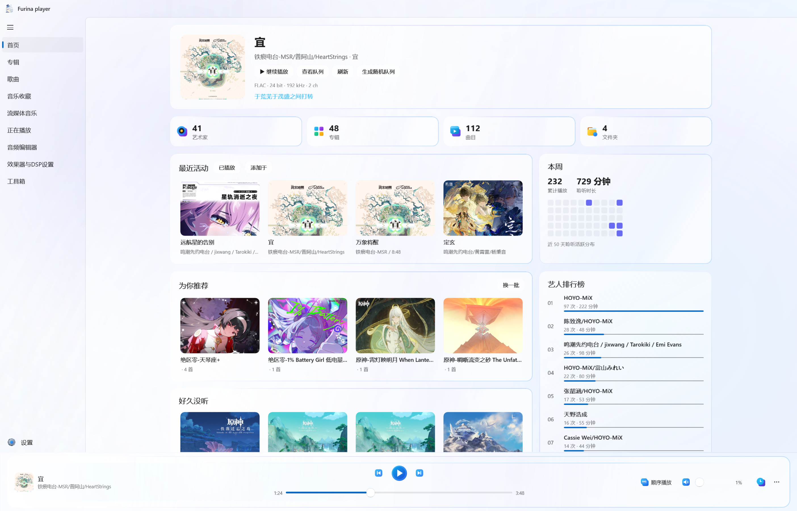
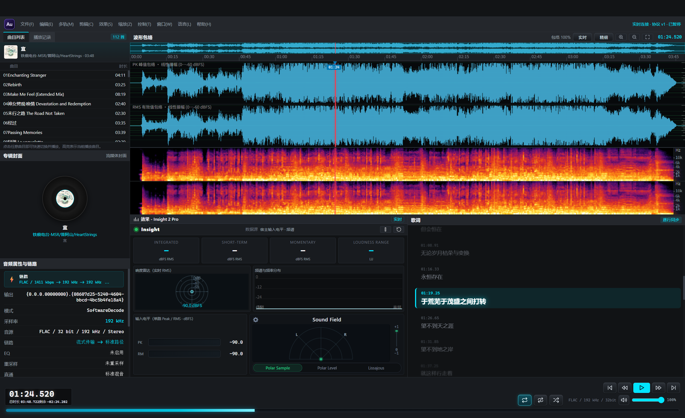
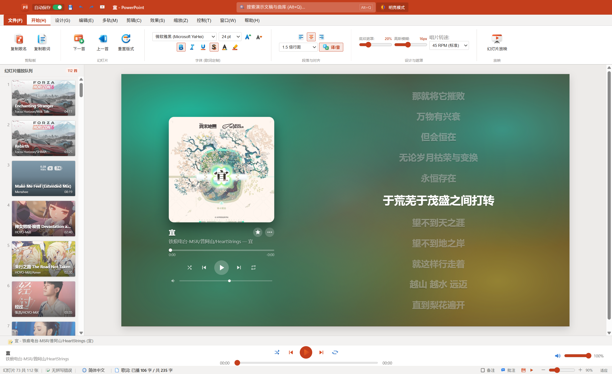
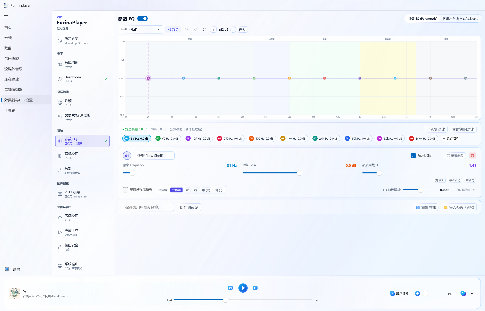
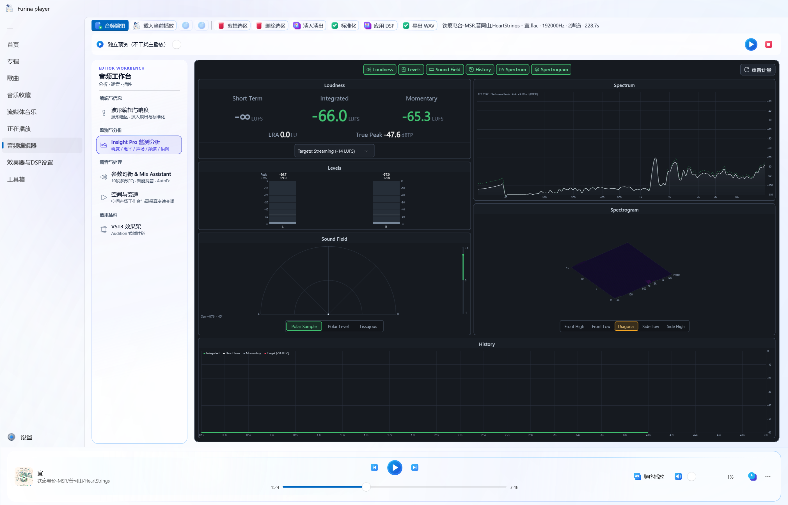
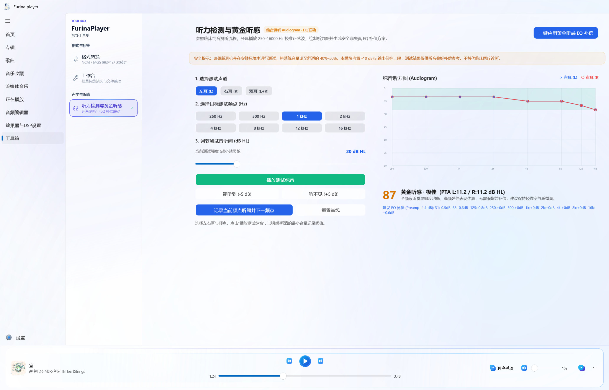

<div align="center">


# FurinaPlayer

基于 WinUI 3 与 .NET 8 的 Windows 桌面无损音乐播放器，内置音频播放、实时 DSP 处理、音频编辑工具以及芙宁娜桌面看板娘。

[](https://github.com/XeonStudio/FurinaPlayer)
[](https://github.com/XeonStudio/FurinaPlayer)
[](https://github.com/XeonStudio/FurinaPlayer/releases)
[](LICENSE)

</div>

## 界面预览

<div align="center">
  
  <p><sub>首页：正在播放卡片、曲库统计、近期播放记录、近 50 天听歌热力图与艺人排行</sub></p>
</div>

<div align="center">

| Audition DAW 播放页主题 | PowerPoint 演示文稿播放页主题 |
| :---: | :---: |
|  |  |
| 10 段参量均衡器与 DSP 机架 | Insight Pro 监测分析（8192 点频谱 / 响度 / 声场） |
|  |  |

</div>

<div align="center">
  
  <p><sub>工具箱中的纯音听力检测（Audiogram），可根据左右耳测听结果生成 EQ 补偿曲线</sub></p>
</div>

## 桌面看板娘与歌词气泡

<div align="center">

| 待机状态 (`Idle`) | 播放律动 (`Groove`) | 点击互动 (`Click`) |
| :---: | :---: | :---: |
|  |  |  |

<br/>


</div>

## 这个播放器能做什么

播放引擎结合了 LibVLC 与 NAudio，支持 WASAPI 共享/独占与 ASIO 输出，可以播放 FLAC、APE、WAV、DSD、ALAC、AAC、MP3 和 OGG 等常见无损与有损格式，并记录退出前的播放进度、队列和顺序模式。

DSP 机架包含 10 段参量均衡器、图形均衡与 Mix Assistant V2、OPRA 耳机校准（内置 700 多个厂商、6,000 多款型号数据）、空间声场调节、32 种预设音效、压限器、多阶重采样与 PCM 转 DSD 调制。所有 DSP 均为独立实现，不依赖第三方闭源音频插件。

音频编辑器用来处理单曲裁剪、淡入淡出和响度标准化，并提供 8192 点 Blackman-Harris FFT 频谱、LUFS 响度、相位声场和语图监测，还支持用 WSOLA 算法实时试听变速与变调效果。

工具箱整合了加密音频解密转码（支持 `.ncm`、`.mgg`、`.kgm` 等格式转为 MP3 或 FLAC）、批量标签清洗整理，以及分耳纯音听力检测。

曲库基于 SQLite 与 EF Core 管理，支持专辑与歌曲即时检索、鼠标拖拽排序收藏歌单、多线程完整性检查补齐、PowerPoint 与 Audition 风格双歌词主题、动态壁纸测试版以及支持自定义系统字体的芙宁娜桌面宠物。

## 最近更新（v1.33.01.0004.1126）

v1.33.01.0004.1126（2026-11-26）主要带来以下改进：

- 设置侧边栏「备份与重置」字体大小现在与其他侧边栏选项保持一致。
- 重新设计「工具箱 → 听力检测与黄金听感」中的测试音听阈滑块，拖动至 60 至 85 dB HL 时二级页面不会再跟随滑块横向平移。
- PowerPoint 歌词主题改为读取并展示系统内已安装的全部字体，并修复专辑封面在异步加载时的显示问题。
- 将启动会话恢复与封面大图解码移至后台异步执行，并加入界面刷新重入保护与节流，减少偶发未响应的情况。

上一版 v1.32.00.0004.1125（2026-11-25）修复了启动续播定位、两种歌词页主题刷新进度归零以及专辑/歌曲搜索框失焦等问题。

## 下载与构建

前往 [Releases](https://github.com/XeonStudio/FurinaPlayer/releases) 下载 `FurinaPlayer-v1.33.01.0004.1126-win-x64.zip`，解压后直接运行 `FurinaPlayer.exe` 即可（Windows 10 1809 或 Windows 11 64 位系统，包内已包含所需运行时）。

如果想从源码自行编译或跑一遍测试：

```powershell
# 编译 Release x64 主程序
dotnet build src\FurinaPlayer\FurinaPlayer.csproj -c Release -p:Platform=x64

# 运行单元测试（251 项）
dotnet run --project src\FurinaPlayerDspTests\FurinaPlayerDspTests.csproj -c Release -p:Platform=x64
```

仓库中的源码分为五个工程：`src/FurinaPlayer` 负责 WinUI 3 主窗口、托盘与桌面宠物；`src/FurinaPlayer.UI` 存放各页面与 ViewModel；`src/FurinaPlayer.Core` 管理曲库、封面歌词服务、多语言词典与设置；`src/FurinaPlayer.Audio` 实现播放后端与全部 DSP 算法；`src/FurinaPlayerDspTests` 为自动化测试套件（当前 251 / 251 通过）。

## 开源组件与接口致谢

| 组件 / 接口 | 用途 | 仓库 / 主页 |
| :--- | :--- | :--- |
| Windows App SDK / WinUI 3 | 桌面 UI 框架与系统集成 | [microsoft/WindowsAppSDK](https://github.com/microsoft/WindowsAppSDK) |
| .NET 8 / EF Core (SQLite) | 运行时与曲库持久化 | [dotnet/dotnet](https://github.com/dotnet/dotnet) |
| CommunityToolkit.Mvvm & WinUI | MVVM 与界面扩展控件 | [CommunityToolkit/dotnet](https://github.com/CommunityToolkit/dotnet) |
| LibVLC & LibVLCSharp | 全格式解码与播放 | [videolan/libvlcsharp](https://github.com/videolan/libvlcsharp) |
| NAudio | WASAPI / ASIO 低延迟输出 | [naudio/NAudio](https://github.com/naudio/NAudio) |
| ATL (Audio Tools Library) | 音频标签、封面与内嵌歌词读写 | [mabdelouahab/atldotnet](https://github.com/mabdelouahab/atldotnet) |
| SkiaSharp | 桌面宠物透明渲染、歌词气泡与音频仪表绘制 | [mono/SkiaSharp](https://github.com/mono/SkiaSharp) |
| MathNet.Numerics & LiveChartsCore | 信号分析与频谱波形图表 | [mathnet/mathnet-numerics](https://github.com/mathnet/mathnet-numerics) |
| FFmpeg | 批量音频格式转换与动态壁纸解码 | [ffmpeg.org](https://ffmpeg.org/) |
| LRCLIB / 网易云 / QQ 音乐 / Apple Music | 在线歌词、元数据与高清封面检索 | [lrclib.net](https://lrclib.net/) |

## 许可证

本项目基于 [Apache License 2.0](LICENSE) 开源。
