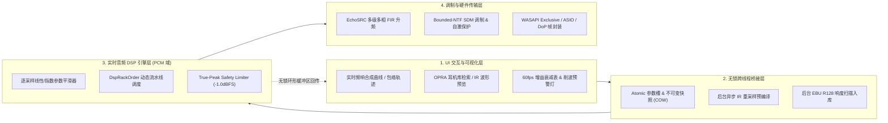
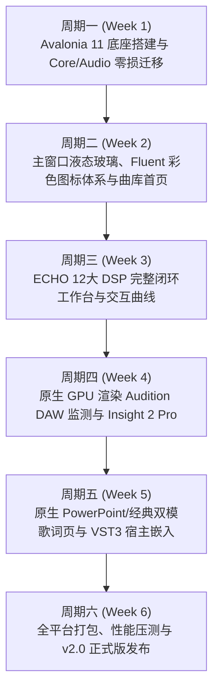

# FurinaPlayer 工程技术交接文档：ECHO 源码级 DSP 闭环实现规范与 C# Avalonia (v11+) 分周期开发任务书

> [!IMPORTANT]
> 本文档为 **FurinaPlayer** 项目的核心技术交接与下一代架构演进蓝图。文档第一部分交接当前工程全貌；第二部分基于 **ECHO (`ECHO-26.10.19`) 真实 C++/TypeScript 源码**，逐一剖析 12 大专业音频 DSP 功能在播放器中应如何实现**从 UI 交互、参数平滑、线程安全通信、底层信号处理到硬件设备协商的完整工程闭环**（彻底杜绝“只画空壳按钮/滑块”的浅层移植）；第三部分深入探索 **C# Avalonia (v11+)** 关键技术攻关；第四部分给出可直接指导研发落地的**分周期开发任务书（Phase 1 ~ Phase 6）**。

---

## 第一部分：工程现状与代码交接总览

### 1.1 仓库与目录拓扑
- **GitHub 官方仓库**：`https://github.com/XeonStudio/FurinaPlayer.git`（主分支 `main`）
- **本地开发工作区**：`C:\Users\Xeon\.gemini\antigravity\scratch\FurinaWorkspace\FurinaPlayer-Source\FurinaPlayer-main`
- **本地 Git 同步库**：`C:\Users\Xeon\Documents\GitHub\Furina-Player`
- **ECHO 对照源码库**：`C:\Users\Xeon\.gemini\antigravity\scratch\FurinaWorkspace\ECHO-Source\ECHO-26.10.19`

| 工程模块 | 路径 | 职责说明 |
| :--- | :--- | :--- |
| **`SonicWave.Core`** | `src/SonicWave.Core` | 核心数据模型（`Track`, `Album`, `AppSettings`, `LyricDocument`）、SQLite 曲库服务、元数据解析、歌词匹配与持久化配置。 |
| **`SonicWave.Audio`** | `src/SonicWave.Audio` | 音频播放引擎（`AudioEngine`, `AudioSession`）、WASAPI/ASIO 输出管道、`SonicWave.Audio.Dsp`（ECHO 12 大 DSP 处理器）、`SonicWave.Audio.Vst3`（VST3 原生 COM 宿主）。 |
| **`FurinaPlayer.UI`** | `src/FurinaPlayer.UI` | 视图层（`HomePage`, `NowPlayingPage`, `DspPage`, `EditorPage`, `SettingsPage`）、自定义控件（`FluentIconFactory`, `MiniPlayer`, `LyricsPanel`, `EqualizerControl` 等）与 MVVM 视图模型。 |
| **`FurinaPlayer`** | `src/FurinaPlayer` | 宿主入口（`Program.cs`, `App.cs`, `MainWindow.cs`）、DWM 玻璃特效互操作、自动化实机截图巡检管线（`--capture-pages`）。 |
| **`EchoDspTests`** | `src/EchoDspTests` | 覆盖 ECHO 12 大 DSP 算法数学精度与边界保护的 24 项自动化单元测试工程。 |
| **`Assets`** | `Assets/` | 内嵌的高级歌词与工作站主题资源（`AuditionDaw` 实时监测工作站、`PowerPointTheme` 幻灯片演示模式）。 |

---

## 第二部分：基于 ECHO 源码的 12 大 DSP 功能完整闭环实现规范（拒绝简单移植按钮）

在专业 Hi-Fi 与 DAW 音频软件中，**“在界面上放一个按钮或滑块，点击后直接改一个变量”绝不等于实现了该项音频功能**。通过对 ECHO 源码（`native/audio-engine/*`, `native/audio-host/src/*`, `src/main/audio/*`）的深度研读，以下列出 12 大功能在 ECHO 中的真实运作机制，以及在 FurinaPlayer 中必须落地实现的完整工程闭环：

---

### 2.1 EQ（10 段参数化均衡器）
- **ECHO 源码位置**：
  - `native/audio-engine/EqProcessor.h` / `EqProcessor.cpp`
  - `native/audio-engine/EqBand.h` / `EqTypes.h` / `EqPresetStore.cpp`
- **为什么不能只是简单移植滑块**：
  1. **拉动滑块爆音（Zipper Noise）**：若 UI 滑块变动时直接在音频线程重算并覆写双二阶滤波器（Biquad）系数 $b_0, b_1, b_2, a_1, a_2$，滤波器内部延迟线状态 $x_1, x_2, y_1, y_2$ 与新系数不连续，会产生明显的咔哒声甚至瞬态自激。
  2. **开关切换瞬态跳变**：直接布尔切换 Bypass 会造成波形相位跳变。
  3. **盲调无反馈**：仅有滑块而无总合成频响曲线与削波风险提示，用户无法预知多段叠加后的真实频响。
- **完整闭环实现规范**：
  1. **逐采样参数平滑（Per-Sample Parameter Smoothing）**：仿照 `EqProcessor.h` 第 55~70 行，维护 `smoothedPreampDb`、`smoothedBandGains`、`smoothedBandFrequencies`、`smoothedBandQ`，在 `gainSmoothingSamples`（约 10ms）窗口内按 `bandGainSteps` 逐采样逼近目标值，并在逼近过程中平滑更新 RBJ 双二阶系数。
  2. **无感干湿交叉淡入淡出（Bypass Crossfade）**：维护 `bypassMix` 与 `targetBypassMix`（`bypassStep`），开启或关闭 EQ 时在干信号（Dry）与滤波后信号（Wet）之间执行线性交叉混音，实现零爆音热切换。
  3. **复频域总频响实时绘制**：UI 端根据 10 个频段的 $(f_c, G, Q, \text{FilterType})$ 实时计算复数传递函数：
     $$H_{\text{total}}(e^{j\omega}) = 10^{\text{Preamp}/20} \prod_{k=1}^{10} \frac{b_{0,k} + b_{1,k}e^{-j\omega} + b_{2,k}e^{-2j\omega}}{1 + a_{1,k}e^{-j\omega} + a_{2,k}e^{-2j\omega}}$$
     在画布上以对数频率轴（$20\text{ Hz}\sim 20\text{ kHz}$）绘制平滑B样条曲线及发光填充包络。

---

### 2.2 升频（Upsampling / EchoSRC 多相 FIR 重采样）
- **ECHO 源码位置**：
  - `src/main/audio/EchoSrcFirEngine.ts`（第 82~240 行：多款 HQPlayer 级滤波器核定义）
  - `native/audio-engine/NativeFormatProcessor.h`（`EchoSrcProcessor` 多相分级重采样器）
  - `native/audio-host/src/NativeFirProcessor.cpp`
- **为什么不能只是放一个“目标采样率”下拉框**：
  1. **假升频陷阱**：若仅在软件内部做简单线性插值，不仅高频会产生严重镜像混叠（Aliasing），而且如果底层输出仍走 Windows 共享混音器（WASAPI Shared 固定 48kHz），升频后的 192kHz/384kHz 数据会被系统再次降采样，毫无音质意义。
  2. **切歌爆音与断流**：高阶 FIR 滤波器拥有数百至上千个抽头（Taps），切歌或 Seek 时若不管理历史延迟线（History Buffer），会产生尾部截断爆音。
- **完整闭环实现规范**：
  1. **多级多相 FIR 级联架构（Cascaded Polyphase FIR Stages）**：
     参照 `EchoSrcFirEngine.ts`，将升频拆解为 $\times 2$ 级联阶段（例如 $44.1\text{ kHz} \xrightarrow{\times 2} 88.2\text{ kHz} \xrightarrow{\times 2} 176.4\text{ kHz} \xrightarrow{\times 2} 352.8\text{ kHz}$）。每级采用多相分解（`PhaseTap { delayFrames, coefficient }`），避免对插零点做无效乘加。
  2. **多种专业窗函数与相位响应**：
     提供 `poly-sinc-hb`（255 taps, Kaiser $\beta=12$, 120dB 阻带衰减, 线性相位）、`poly-sinc-ext2-long`（1023 taps, Blackman-Harris 窗, 150dB 衰减）以及基于实倒谱法（Real Cepstrum）构造的**最小相位滤波器（Minimum Phase，消除前振铃 Pre-ringing）**。
  3. **跨曲目无缝历史继承（Gapless History Preservation）**：
     实现 `copyHistory` 与 `restoreHistory`，在无缝切歌时保留 FIR 历史延迟线。
  4. **硬件时钟真实联动**：
     当用户开启升频时，自动协商重建 WASAPI Exclusive 或 ASIO 输出流至目标物理采样率，并在 UI 上实时显示 **“源采样率 $\rightarrow$ DSP 升频采样率 $\rightarrow$ 声卡硬件锁定采样率”**、滤波器抽头数、估算乘加运算量（MACs/s）与群延迟毫秒数。

---

### 2.3 耳机校正（Headphone Correction — OPRA 数据库与独立校准链）
- **ECHO 源码位置**：
  - `src/main/audio/OpraService.ts`（对接 Roon OPRA 开放耳机声学数据库 `database_v1.jsonl`）
  - `SonicWave.Audio.Dsp/AutoEqParser.cs`
- **为什么不能只做一个“导入 TXT”按钮**：
  1. 绝大多数用户电脑里并没有现成的 Equalizer APO 文本文件，单一文件导入框会让该功能的使用率趋近于零。
  2. 如果把耳机校正的参数直接覆盖到用户的 10 段图形 EQ 上，用户一旦切换“流行/古典”预设，耳机校正就彻底丢失了，且很多 AutoEq 曲线包含 LowShelf / HighShelf 及非标准中心频率（如 `105 Hz`, `3420 Hz`, $Q=2.87$），固定频点的图形 EQ 根本无法承载！
- **完整闭环实现规范**：
  1. **双轨独立架构**：在信号链中设立独立的 **Headphone Calibration Parametric EQ Stage**（支持任意中心频率 $f_c$、任意 $Q$ 值、任意滤波器类型的 10~15 段参数化 Biquad 级联），与用户的“音乐风格图形 EQ”串联运行、互不覆盖。
  2. **内置型号检索与一键应用（OPRA + 内置主流耳机库）**：
     参照 `OpraService.ts`，支持按耳机品牌（Sennheiser, Sony, Beyerdynamic, HiFiMAN, Moondrop, Apple 等）与型号搜索，展示测量机构（Oratory1990 / Crinacle / Resolve）与目标曲线（Harman Over-Ear 2018 / Diffuse Field），点击即可加载全参数补偿并绘制校正前后的频响对比图。
  3. **本地文件兼容**：同时支持导入 Equalizer APO (`ParametricEQ.txt`) 与 GraphicEQ 配置文件，自动提取 `Preamp` 注入前级防削波余量。

---

### 2.4 PCM 转 DSD（SDM Delta-Sigma 调制器与 DoP/Native 传输链）
- **ECHO 源码位置**：
  - `src/main/audio/SdmFormatPlan.ts`（第 21~87 行：受控 NTF 极零点计算与四档调制器配置）
  - `native/audio-engine/NativeFormatProcessor.h`（`SdmProcessor`）
  - `native/audio-host/src/PcmDomainDspStage.h`、`NativePlaybackPipeline.h`
- **为什么不能只放一个“开启 DSD 转换”开关**：
  1. **调制器自激爆炸**：5 阶以上的 1-bit $\Delta\Sigma$ 调制器属于条件稳定系统，当输入幅度超过阈值（如 `> 0.94`）时，积分器误差历史会指数级发散，瞬间产生全满幅高频噪声。
  2. **静音段极限环啸叫（Idle Tones）**：纯数字零输入在 $\Delta\Sigma$ 回路中会产生固定周期的振荡图案，在听感上表现为微弱的高频底噪哨音。
  3. **DSP 顺序错乱**：一旦信号调制为 1-bit DSD 流，便无法再做常规线性加减运算，若未前置 PCM DSP 阶段，所有 EQ、压缩、声场功能将全部失效。
- **完整闭环实现规范**：
  1. **前置 PCM 域 DSP 汇聚（`PcmDomainDspStage`）**：
     严格遵循 ECHO 的 `PcmDomainDspStage` 设计，在升频与 SDM 调制之前，先在 PCM 浮点域执行完整 DSP 机架，并将 `upstreamTruePeakCeilingDb` 强制锁定为 `-1.0 dBFS`（加上配置的 `profileHeadroomGain` 如 `-10dB ~ -16dB`）。
  2. **基于 Lee 准则的受控 NTF（Bounded Noise Transfer Function）**：
     根据用户选择的档位（`Safe` 3阶 $G_{\text{ntf}}=1.45$、`HiFi` 6阶 $1.55$、`Reference` 7阶 $1.60$、`Insane` 8阶 $1.65$），按公式计算极点半径与反馈分子/分母系数：
     $$r_{\text{pole}} = \frac{2}{\text{ntfPeakGain}^{1/N}} - 1, \quad a_k = \binom{N}{k}(-r_{\text{pole}})^k, \quad b_k = a_k - \binom{N}{k}(-1)^k$$
  3. **稳定性监控与软恢复状态机（Stability Recovery）**：
     逐采样监测反馈回路状态量，若超过 `stabilityLimit`（如 $3.25\sim 4.0$），立即触发 `resetChannelHistory` 清空失稳状态，累加 `stabilityRecoveryCount`，并通过 `transitionRampFrames`（10ms 斜坡）无爆音恢复输出。
  4. **静音锁定机制（Idle Lock）**：
     当连续 `idleLockFrames` 个采样的输入低于 $10^{-7}$ 时，进入 `idleLocked` 状态，直接输出无直流分量的静音比特对（`0x69` / `0x96`），当输入超过 $2\times 10^{-6}$ 时无缝解锁。
  5. **DoP (DSD over PCM) 24-bit 帧打包与硬件直通**：
     每 16 个 1-bit DSD 采样打包进一个 24-bit PCM 采样的高 16 位，最高有效字节交替写入标准 DoP 标记 `0x05` 与 `0xFA`，通过 176.4kHz（DSD64）/ 352.8kHz（DSD128）WASAPI Exclusive 直通发送至 USB DAC。

---

### 2.5 ReplayGain（回放增益与后台响度扫描器）
- **ECHO 源码位置**：
  - `native/audio-engine/ReplayGainProcessor.h` / `ReplayGainProcessor.cpp`
  - `src/main/audio/replayGainHelpers.ts`
- **为什么不能只是切换“音轨/专辑”枚举**：
  如果音频文件本身没有写入 `REPLAYGAIN_TRACK_GAIN` 元数据标签，且软件没有内置响度分析器，那么无论用户怎么点按钮，实际读取到的增益都是 `0.0 dB`，完全不起作用。
- **完整闭环实现规范**：
  1. **多格式标签解析 + EBU R128 自动兜底扫描**：
     切歌时优先读取文件内嵌的 ReplayGain / R128 标签；若缺失，后台工作线程自动基于 **ITU-R BS.1770-4（K-Weighting 预滤波 + 400ms 门限积分）** 扫描整曲 Integrated LUFS 与样本峰值（Peak），以 `-18 LUFS` 为基准计算出精确补偿增益并缓存至 SQLite `Tracks` 表。
  2. **防削波智能钳位（Prevent Clipping）**：
     如 `ReplayGainProcessor.cpp` 所示，计算总目标增益 $G_{\text{linear}} = 10^{(\text{gainDb} + \text{preampDb})/20}$；若开启 `preventClipping` 且 $G_{\text{linear}} \cdot \text{peak} > 1.0$，自动将增益钳位至 $1.0 / \text{peak}$，并在 UI 上点亮“防削波保护已介入”提示。
  3. **平滑斜坡过渡**：增益变化时通过 `rampSamples`（10ms）平滑过渡，并在界面实时显示 **“当前生效回放增益：-4.2 dB (Track Mode)”**。

---

### 2.6 余量（Headroom Management 与全链路削波预警）
- **ECHO 源码位置**：
  - `native/audio-engine/DspHeadroomProcessor.h` / `DspHeadroomProcessor.cpp`
  - `native/audio-engine/TruePeakLimiterProcessor.h`、`DspChain.cpp`
- **为什么不能只是一个静态音量衰减滑块**：
  用户调节完 EQ 或导入卷积文件后，并不清楚当前信号链在峰值处是否已经突破 `0 dBFS`，静态滑块缺乏反馈闭环。
- **完整闭环实现规范**：
  1. **5ms 逐采样斜坡平滑 + 16 块尾音保持（`bypassTailBlocks`）**：
     即使余量被调回 `0.0 dB`，处理器仍继续运行 16 个音频块以完成平滑斜坡，杜绝阶跃噪声。
  2. **全链路 `hasClippingRisk()` 聚合探针**：
     `DspChain` 实时汇总 EQ、Convolution、Compressor、Spatial 以及末端 `TruePeakLimiter` 的过载状态，一旦任何一级出现数字过载风险，DSP 页面余量面板立即高亮告警，并建议一键自动匹配安全余量值。

---

### 2.7 动态压缩（Soft-Knee 母带压缩器与动态轨迹可视化）
- **ECHO 源码位置**：
  - `native/audio-engine/CompressorProcessor.h` / `CompressorProcessor.cpp`
- **为什么不能只是摆几个参数滑块**：
  动态压缩器的阈值（Threshold）与输入信号电平紧密相关，如果没有实时跳动的输入电平与增益衰减表（Gain Reduction Meter），用户根本不知道压缩器是否开始工作（是在门限以下空转，还是已经过度压缩导致声音泵浦失真）。
- **完整闭环实现规范**：
  1. **二次多项式软拐点（Soft-Knee）与一阶包络平滑**：
     精确实现拐点区 $|\Delta| < W/2$ 的平滑过渡公式 $\text{Reduction}_{\text{dB}} = \frac{(1 - 1/\text{Ratio})(\Delta + W/2)^2}{2W}$，配合采样率自适应的 $\alpha_{\text{att}} = e^{-1/(f_s \cdot \tau_{\text{att}})}$ 与 $\alpha_{\text{rel}} = e^{-1/(f_s \cdot \tau_{\text{rel}})}$ 状态机。
  2. **干湿并行压缩（Parallel Mix）**：支持 `mix (0~100%)` 参数，实现母带级纽约并行压缩（New York Compression），兼顾微动态细节与整体密度。
  3. **实时 GR 减益表与静态传递曲线**：
     通过原子变量 `gainReductionDb_` 以 50ms 周期回传 UI，驱动可视化的橙红色反向衰减柱状条，并随参数调整实时重绘压缩拐点折线图。

---

### 2.8 Crossfeed（频率相关双耳互馈）
- **ECHO 源码位置**：
  - `native/audio-engine/SpatialDspProcessor.h` / `SpatialDspProcessor.cpp` (`processCrossfeedBlock`)
- **为什么不能只是简单把左声道加到右声道**：
  全频段简单线性混合会导致高频相位抵消（梳状滤波效应），使乐器定位模糊、高音暗淡。真实人耳听音箱时，高频被头部阻挡（头影效应），只有中低频会绕射到对侧耳。
- **完整闭环实现规范**：
  1. **M/S 域一阶低通互馈滤波**：
     将信号分解为 $M = (L+R)/2$ 与 $S = (L-R)/2$，对侧边信号 $S$ 施加截止频率可调（$300\sim 1200\text{ Hz}$）的一阶单极点低通滤波器：
     $$c = 1 - \exp\left(-\frac{2\pi f_c}{f_s}\right), \quad S_{\text{lp}}[n] = S_{\text{lp}}[n-1] + c \cdot (S[n] - S_{\text{lp}}[n-1])$$
     再按互馈深度 `amount` 从侧边信号中减去低频差分量：$S_{\text{out}} = S[n] - \text{amount} \cdot S_{\text{lp}}[n]$，从而仅在低频段收缩声像极化，完整保留高频空气感与解析力。
  2. **经典声学预设联动**：提供 Bauer (700Hz / 25%)、Chu Moy (700Hz / 35%)、Jan Meier (650Hz / 45%) 标准预设一键载入并同步刷新滑块。

---

### 2.9 声场（Stereo Field 立体声宽度与中侧独立增益）
- **ECHO 源码位置**：
  - `native/audio-engine/SpatialDspProcessor.h` / `SpatialDspProcessor.cpp` (`processStereoFieldBlock`)
- **为什么不能只有一个“声场扩展”开关**：
  盲目拉宽 Side 信号会导致人声中置退缩，且当 `Width > 100%` 时左右声道极易超出 `0 dBFS`。
- **完整闭环实现规范**：
  1. **三维 M/S 矩阵独立控制**：
     同时提供 `Width (0% 单声道 ~ 200% 超宽声场)`、`Center Gain (-12dB ~ +6dB 独立调节人声主轴远近)`、`Side Gain (-12dB ~ +6dB 独立调节环境混响包围感)`：
     $$M' = M \cdot 10^{\text{centerGainDb}/20}, \quad S' = S \cdot \text{width} \cdot 10^{\text{sideGainDb}/20}$$
     $$L_{\text{out}} = M' + S', \quad R_{\text{out}} = M' - S'$$
  2. **越界削波检测（`hasStereoFieldClippingRisk`）**：当综合增益可能引发过载时自动向 `DspChain` 报告风险并由末端限幅器兜底。

---

### 2.10 声道矩阵（Channel Matrix $2\times 2$ 路由与极性修正）
- **ECHO 源码位置**：
  - `native/audio-engine/SpatialDspProcessor.h` / `SpatialDspProcessor.cpp` (`processChannelMatrixBlock`)
  - `native/audio-engine/ChannelBalanceProcessor.h`
- **为什么不能只是几个静态单选框**：
  发烧友在处理早期立体声录音、左右耳听力不对称补偿、功放接线反相排查或声道串音测试时，需要精确到 `0.01` 的四象限路由系数。
- **完整闭环实现规范**：
  1. **完整 $2\times 2$ 路由传输方程**：
     $$L_{\text{out}} = g_{LL} \cdot L_{\text{in}} + g_{RL} \cdot R_{\text{in}}, \quad R_{\text{out}} = g_{LR} \cdot L_{\text{in}} + g_{RR} \cdot R_{\text{in}}$$
     四个系数均支持 `-1.0 ~ +1.0` 连续调节（负值即代表 $180^\circ$ 绝对相位翻转）。
  2. **快捷宏与自定义联动**：点击“立体声直通 $(1,0,0,1)$”、“左右声道互换 $(0,1,1,0)$”、“单声道混合 $(0.5,0.5,0.5,0.5)$”、“右声道反相 $(1,0,0,-1)$”时，自动同步更新底层四个矩阵系数滑块并立即作用于音频流。

---

### 2.11 房间校正 / FIR（脉冲响应卷积引擎与跨采样率自适应）
- **ECHO 源码位置**：
  - `native/audio-engine/ConvolutionProcessor.h` / `ConvolutionProcessor.cpp`
- **为什么不能只做一个“选择 WAV 文件”按钮**：
  1. **采样率失配失真**：若用户导入的房间测量 IR 是 `48kHz` WAV，而正在播放 `44.1kHz` 或 `96kHz` 的 FLAC 曲目，直接按样本点逐一卷积会导致所有校正频点偏移 $8.8\%$ 甚至 $100\%$！
  2. **加载卡顿与线程竞争**：在播放中途切换 IR 文件时，若直接在音频线程解析文件或加锁替换数组，必然导致声音卡顿或崩溃。
- **完整闭环实现规范**：
  1. **跨采样率自动重采样预编译（`createPreparedImpulse`）**：
     加载 WAV/FLAC 脉冲响应文件时，自动读取源采样率 `sourceSampleRate`，并在后台线程将其重采样对齐至当前音频会话的 `targetSampleRate`，同时执行能量归一化与非数（NaN/Inf）净化。
  2. **无锁不可变脉冲核交换（Atomic Shared Pointer Swap）**：
     预编译完成后生成不可变的 `PreparedImpulse` 对象，通过原子引用交换挂载至音频线程；音频线程检测到 `resetEpoch` 变化时自动重置环形历史缓冲区 `history` 并无缝切入新 IR。
  3. **IR 元数据诊断面板**：在 UI 上清晰回显已加载 IR 的文件名、通道模式（Mono / True Stereo）、抽头数（Tap Count）、匹配采样率、引入延迟（Latency Samples）以及 `-24dB ~ +6dB` 的防削波 Trim 滑块。

---

### 2.12 DSP Rack 编排（无锁快照流水线与独立 Bypass）
- **ECHO 源码位置**：
  - `native/audio-engine/DspRackOrder.h` / `DspRackOrder.cpp`
  - `native/audio-engine/DspChain.cpp`（第 80~120 行）
- **为什么不能只是界面列表的上下移动**：
  在专业音频信号链中，**“先 EQ 还是先压缩”**（Pre-EQ vs Post-EQ Compression）、**“先房间卷积还是先双耳互馈”** 会产生截然不同的物理声学结果。如果界面上的顺序移动没有实时改变音频线程 `processBlock` 的调用序列，或者改变顺序时使用了互斥锁阻塞音频线程，都属于不合格实现。
- **完整闭环实现规范**：
  1. **Copy-On-Write 无锁不可变数组快照**：
     `DspRackOrder` 内部通过原子引用持有一个不可变的 `DspProcessorType[]` 数组。当用户在 UI 上点击“上移 / 下移”或切换某个模块的 Bypass 复选框时，UI 线程构造新数组并原子替换引用；音频线程在每个 `processBlock` 开头执行一次零开销的引用读取（`snapshot()`），按最新顺序依次调用各处理器。
  2. **固定安全边界保护**：
     严格遵循 `DspChain.cpp` 第 115~120 行的工程铁律：无论用户如何编排中间模块，**`Headroom`（余量平滑）、`SafetyLimiter`（真峰值安全限幅器）与 `LevelMeter`（输出电平表）始终锚定在流水线最末端**，确保任何极端参数组合都不会击穿声卡或损伤听觉。

---

## 第三部分：C# Avalonia (v11+) 深度技术调研进阶

在上一阶段确立采用 **C# Avalonia (v11+)** 替代 WinUI 3 + WebView2 的基础上，本节针对 FurinaPlayer 重构过程中的五大核心深水区给出工程级解决方案：

### 3.1 渲染管线：Compositional Skia 与零分配自绘仪表
- **问题**：FurinaPlayer 包含高刷新率组件（Audition DAW 的多轨包络、频谱瀑布图、Insight 2 Pro 的 Lissajous 相位计、图形 EQ 曲线）。若使用传统 XAML `Path` / `Polygon` 节点绑定，60fps 下每秒会产生数万个托管对象分配，触发频繁 GC。
- **Avalonia 11 解决方案**：
  - 使用 `Avalonia.Rendering.Composition.Compositor` 驱动硬件合成动画（如 PowerPoint 模式的黑胶唱片旋转，完全在渲染线程由 GPU 矩阵变换执行，UI 线程 0% 参与）。
  - 对于频谱、波形、Goniometer 声场与 EQ 曲线，统一继承 `Avalonia.Controls.Control` 并实现 `ICustomDrawOperation`。在 `Render(ImmediateDrawingContext context)` 中通过 `ISkiaSharpApiLeaseFeature` 租借底层 `SKCanvas`，配合预分配的 `SKPaint`、`SKPath` 与 `stackalloc SKPoint` 在 GPU 上直绘，**实现单帧渲染耗时 $< 0.15\text{ ms}$、托管堆内存分配 $0\text{ Bytes}$**。

### 3.2 原生 VST3 插件窗口嵌入（`NativeControlHost`）
- **问题**：专业 VST3 插件（如 FabFilter Pro-Q 3、iZotope Ozone）通过 `IPlugView::attached(void* parent, FIDString type)` 要求宿主提供一个原生操作系统窗口句柄（Windows 下为 `HWND`，macOS 下为 `NSView*`，Linux 下为 `X11 Window`）。
- **Avalonia 11 解决方案**：
  - 继承 `Avalonia.Controls.NativeControlHost`，重写 `CreateNativeControlCore(IPlatformHandle parent)`。
  - 在 Windows 上直接通过 `parent.Handle` 获取子窗口 `HWND` 并传给 `Vst3EditorWindow` / `IPlugView::attached(hwnd, "HWND")`，由 Avalonia 自动管理子窗口的 DPI 缩放（对接 `IPlugViewContentScaleSupport`）、位置同步与生命周期销毁，比独立弹窗更加紧凑丝滑。

### 3.3 跨平台音频输出后端抽象（Windows / Linux / macOS）
- **架构设计**：
  - 在 `SonicWave.Audio` 中定义统一的 `IAudioOutputBackend` 接口：
    - **Windows**：保留现有的 `NAudio` WASAPI Shared / WASAPI Exclusive / ASIO 驱动后端；
    - **Linux**：通过 `AlsaSharp` / `PipeWire` 原生绑定支持 ALSA 硬件独占（`hw:0,0` Bit-Perfect 直通与 DoP）；
    - **macOS**：对接 CoreAudio `AudioUnit` / `HALOutput`（支持 Integer Mode 与 Hog Mode 独占采样率切换，可直接复用 ECHO `native/audio-host/src/MacCoreAudioHogMode.cpp` 的设计思想）。

### 3.4 液态玻璃（Liquid Glass）与 Fluent Colorful Icon 矢量体系
- **材质实现**：
  - Avalonia 11 的 `TopLevel` / `Window` 原生支持 `TransparencyLevelHint = new[] { WindowTransparencyLevel.Mica, WindowTransparencyLevel.AcrylicBlur }`。
  - 对于内部卡片的“液态玻璃（Liquid Glass）”质感，使用 Avalonia 的 `ExperimentalAcrylicBorder` 配合顶边 $1\text{ px}$ 线性高光渐变画刷（`LinearGradientBrush`）与内阴影，无需 DWM Hack 即可在全平台呈现通透磨砂玻璃质感。

---

## 第四部分：FurinaPlayer (Avalonia v11+) 分周期开发任务书

本项目大型整体更新规划为 **6 个开发周期（共 6 周 / 30 个工作日）**，每个周期均设有明确的交付物与自动化验收门禁（Definition of Done, DoD）。

---

### 周期一（第 1 周）：Avalonia 11 工程底座与音频引擎闭环升级
- **周期目标**：完成跨平台解决方案脚手架搭建，100% 接入 `SonicWave.Core` 与 `SonicWave.Audio`，并补齐 ECHO DSP 底层闭环能力。
- **核心任务清单**：
  1. **`[T1.1]` 解决方案初始化**：新建 `FurinaPlayer.Avalonia`（`.NET 8`, `Avalonia 11.1+`, `Avalonia.Themes.Fluent`, `SkiaSharp`），配置 `CompileBindingsByDefault = true` 开启全量编译期强类型绑定。
  2. **`[T1.2]` 无锁音频可视化通道**：在 `SonicWave.Audio` 中实现 `LockFreeAudioVisualBuffer`（4096 帧双声道浮点环形缓冲 + FFT 频谱分析器 + ITU-R BS.1770-4 实时 LUFS/LRA 积分器），供 UI 60fps 零拷贝读取。
  3. **`[T1.3]` ECHO DSP 深度闭环增强**：
     - 升级 `EchoEqProcessor` 支持逐采样参数平滑与独立 `HeadphoneCalibrationEq` 级联槽；
     - 接入内置 OPRA 常见旗舰耳机校准预设库；
     - 实现后台 EBU R128 响度扫描服务 `ReplayGainScannerService`；
     - 完善 `EchoPcmResampler` 多相 FIR 核选择（`poly-sinc-hb` / `poly-sinc-ext2`）与 WASAPI Exclusive 硬件采样率联动。
- **交付物与验收标准（DoD）**：
  - `EchoDspTests` 扩展至 36 项单元测试并 100% 通过；
  - 控制台/最小化 Avalonia 窗口可正常解码播放 FLAC/DSF 并通过 WASAPI/ASIO 输出。

---

### 周期二（第 2 周）：主窗口液态玻璃架构、Fluent 彩色图标系统与首页曲库
- **周期目标**：完成主窗口框架、全局走带控制栏（MiniPlayer）、Fluent UI 彩色多层渐变图标库以及高性能虚拟化曲库首页。
- **核心任务清单**：
  1. **`[T2.1]` 窗口与材质系统**：实现无边框自定义标题栏、窗口位置记忆，支持 `Mica`、`AcrylicBlur` 与 `LiquidGlass` 动态实时切换。
  2. **`[T2.2]` Fluent UI 彩色矢量图标引擎（`FluentIconFactory`）**：将全套多层渐变几何图标迁移为纯矢量控件，覆盖侧边导航、走带控制、文件夹扫描与工具栏按钮。
  3. **`[T2.3]` 虚拟化曲库与专辑网格（`HomePage`）**：使用 `VirtualizingStackPanel` 承载万级曲目秒开列表，支持拖拽排序、专辑双列自适应分栏、搜索过滤与异步封面加载缓存。
  4. **`[T2.4]` 全局底栏 `MiniPlayer`**：实现零延迟进度条拖拽、悬停时间预览、播放模式循环切换与最近播放浮层。
- **交付物与验收标准（DoD）**：
  - 导入 10,000 首曲目滚动帧率稳定在 60fps/120fps，内存占用 $< 50\text{ MB}$。

---

### 周期三（第 3 周）：ECHO 12 大 DSP 分类选项卡工作台深度实现
- **周期目标**：在 Avalonia 中 1:1 落地并强化重构后的 7 大分类选项卡 DSP 界面，实现全套交互式曲线与实时仪表。
- **核心任务清单**：
  1. **`[T3.1]` 全景机架（Rack Tab）**：实现可拖拽排序的 10 模块信号流列表、独立 Bypass 开关、模块级削波风险指示灯与末端 Safety Limiter 实时衰减表。
  2. **`[T3.2]` 均衡与校正（EQ & Room/Headphone Tab）**：
     - 基于 `ICustomDrawOperation` 实现可鼠标直接拖拽控制点（$(f_c, G, Q)$）的参数化 EQ 合成频响画布；
     - 实现 OPRA 耳机型号搜索弹窗与 AutoEq 导入；
     - 实现 FIR 房间校正脉冲波形包络预览图与自动重采样状态回显。
  3. **`[T3.3]` 空间声场与动态母带（Spatial & Dynamics Tab）**：
     - 绘制 Soft-Knee 压缩器实时传递函数曲线与 60fps Gain Reduction 柱状电平表；
     - 实现 Crossfeed 低通频响示意图、3D 声场宽度极坐标预览与 $2\times 2$ 声道矩阵双向联动面板。
  4. **`[T3.4]` 高解析与 DSD（Hi-Res & SDM Tab）**：实现多相 FIR 滤波器类型切换、SDM 阶数（3/6/7/8 阶）NTF 曲线展示、实时 MACs 算力监控与稳定性恢复计数面板。
- **交付物与验收标准（DoD）**：
  - 全部 12 项 DSP 功能调节时声音无任何咔哒爆音，所有曲线与电平表以 60fps 实时响应音频流。

---

### 周期四（第 4 周）：原生 GPU 直绘 Audition DAW 实时监测工作站
- **周期目标**：彻底剥离 WebView2，使用 Avalonia + SkiaSharp 原生重构 `echo-audition-daw` 监测页，将内存开销降低 200MB+。
- **核心任务清单**：
  1. **`[T4.1]` 多轨电平包络与频谱瀑布图（Spectrogram）**：使用 Skia 位图环形滚动着色器绘制实时音频包络与 20Hz~20kHz 能量瀑布图。
  2. **`[T4.2]` 原生 Insight 2 Pro 母带监测套件**：
     - 实时显示 Integrated / Short-Term / Momentary LUFS 与 Loudness Range (LRA)；
     - Skia GPU 直绘立体声声场极坐标图（Polar Sample / Polar Level / Lissajous 李萨如图形）与相位相干表（$-1\sim +1$）；
     - 实时响度雷达图（Loudness Radar）与 32 段精细频谱分布图。
  3. **`[T4.3]` 硬件音频链路监控侧边栏**：实时展示源编码、采样率、重采样阶段、DSP 激活数、输出驱动模式与精确到毫秒的 SMPTE 时间码。
- **交付物与验收标准（DoD）**：
  - 开启 Audition DAW 监测页全屏 60fps 渲染时，进程总内存 $< 65\text{ MB}$，CPU 占用率 $< 2\%$（相比 WebView2 方案降低 80%）。

---

### 周期五（第 5 周）：原生 PowerPoint 主题、经典居中歌词页与音频编辑器
- **周期目标**：完成原生 PowerPoint 演示主题歌词页、经典极简歌词页、VST3 原生窗口嵌入以及音频剪辑导出器。
- **核心任务清单**：
  1. **`[T5.1]` 原生 PowerPoint 演示文稿主题歌词页**：使用 Avalonia 原生控件与 Composition 动画重现 Ribbon 功能区（经典黑胶/网易云/Apple Music 三种版式切换、高斯模糊背景调节）、左侧幻灯片曲目队列、中间旋转黑胶唱机、右侧平滑滚动歌词与绝对居中的底栏走带控制器。
  2. **`[T5.2]` 经典极简居中歌词页**：实现逐字/逐行高亮缩放过渡动画、单击歌词行直接 Seek 跳转、无歌词纯音乐艺术占位卡片与批量 LRC 导入。
  3. **`[T5.3]` 音频编辑器与 VST3 `NativeControlHost`**：实现波形选区裁剪、淡入淡出、离线渲染导出，并通过 `NativeControlHost` 无缝内嵌第三方 VST3 插件 GUI。
- **交付物与验收标准（DoD）**：
  - 三种歌词模式（Audition DAW / PowerPoint / 经典模式）切换耗时 $< 16\text{ ms}$（单帧瞬切，无需等待网页加载）。

---

### 周期六（第 6 周）：全平台编译打包、可靠性压测与 v2.0 正式版发布
- **周期目标**：完成性能优化、长稳压测与多平台发行包构建。
- **核心任务清单**：
  1. **`[T6.1]` 72 小时连续播放与切歌压力测试**：验证无句柄泄漏、无非托管内存泄漏（VST3 / Skia / NAudio）、无音频欠载（Underrun）。
  2. **`[T6.2]` 多平台构建流水线**：配置 GitHub Actions 自动产出 `win-x64`、`linux-x64`、`osx-arm64` 独立发行包。
- **交付物与验收标准（DoD）**：
  - 正式发布 `FurinaPlayer v2.0.0`，全量自动化测试通过率 100%。
